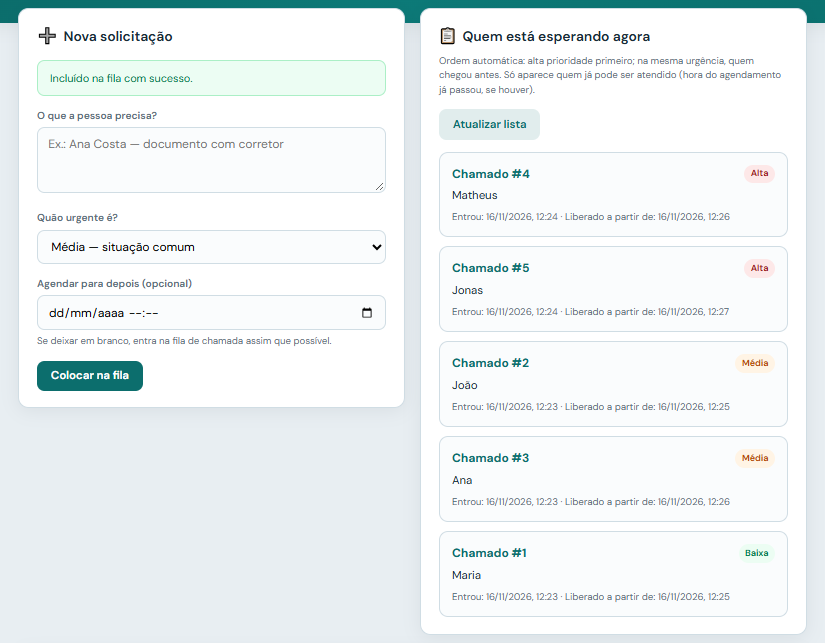

## Queue Manager (Fila Inteligente)

[](https://github.com/Math0707/queue/actions/workflows/ci.yml)

Backend (API REST) para gerenciamento de filas com **prioridade**, **status** e **agendamento**. Inclui **painel web** em português, **Swagger**, perfis **dev** (H2) e **prod** (PostgreSQL), **Docker Compose** e **CI no GitHub Actions**.

> **English summary:** REST API for priority queues with scheduling, built with Java 21 and Spring Boot 3. Tasks are served by priority (HIGH > MEDIUM > LOW) and FIFO on ties; scheduled tasks only become eligible when their time arrives. Concurrent claims are protected with optimistic locking (`@Version` → `409 Conflict`). Includes unit and integration tests, CI on GitHub Actions, H2/PostgreSQL profiles and Docker Compose.



### Stack

- Java 21
- Spring Boot 3.5.x
- Spring Web + Spring Data JPA + Validation
- Banco: **H2** (desenvolvimento/testes) ou **PostgreSQL** (Docker/produção)
- JUnit 5 + Mockito + MockMvc
- Maven Wrapper (`mvnw`)

### Regras da fila

- Ordem de atendimento: **prioridade** (`HIGH` > `MEDIUM` > `LOW`); empate → **ordem de chegada** (FIFO).
- Solicitação com `scheduledFor` no futuro não aparece na fila até o horário chegar.
- Ciclo de vida: `PENDING` → (`POST /queue/claim`) → `PROCESSING` → (`POST /tasks/{id}/complete`) → `DONE`.
- Só é possível concluir quem está em `PROCESSING` (senão `409 Conflict`).

### Concorrência

Dois atendentes podem chamar o próximo ao mesmo tempo. A entidade `Task` usa **lock otimista** (`@Version`): se duas requisições tentarem mudar a mesma solicitação, a segunda falha com `ObjectOptimisticLockingFailureException`, que o `ApiExceptionHandler` transforma em **`409 Conflict`** com uma mensagem orientando a chamar o próximo de novo. Ninguém é atendido duas vezes. Isso é coberto pelo teste `staleVersion_isRejected`.

### Rodar local

Pré-requisito: **JDK 21** com **JAVA_HOME** configurado.

**Linux / macOS**

```bash
git clone https://github.com/Math0707/queue.git
cd queue
./mvnw spring-boot:run
```

**Windows (PowerShell)**

```powershell
git clone https://github.com/Math0707/queue.git
cd queue
.\mvnw.cmd spring-boot:run
```

- **Painel:** `http://localhost:8080/`
- **Swagger:** `http://localhost:8080/swagger-ui.html`
- **H2 (só dev):** `http://localhost:8080/h2` — JDBC `jdbc:h2:mem:queue`, user `sa`, senha vazia.

### Testes

```bash
./mvnw verify          # Linux / macOS
.\mvnw.cmd verify      # Windows
```

| Classe | Tipo | O que cobre |
|--------|------|-------------|
| `QueueServiceTest` | Unitário (Mockito) | Ordenação por prioridade, FIFO, agendamento, `claim` |
| `TaskServiceTest` | Unitário (Mockito) | Criação, conclusão e transições de status inválidas |
| `QueueApiIntegrationTest` | Integração (MockMvc + H2) | Fluxo HTTP completo, validação (400), conflito (409), fila vazia (404), concorrência (lock otimista) |
| `QueueApplicationTests` | Smoke | Contexto do Spring sobe |

O workflow **CI** (`.github/workflows/ci.yml`) roda `./mvnw verify` em cada push/PR para `main` ou `master`, também contra PostgreSQL.

### Perfis Spring

| Perfil | Uso | Banco |
|--------|-----|--------|
| `dev` (padrão) | `mvnw spring-boot:run` local e testes | H2 em memória + console `/h2` |
| `prod` | Docker ou servidor | PostgreSQL (`SPRING_DATASOURCE_*`) |

Arquivos: `application.properties` (comum), `application-dev.properties`, `application-prod.properties`.

Produção local com Postgres já rodando:

**Linux / macOS**

```bash
export SPRING_PROFILES_ACTIVE=prod
export SPRING_DATASOURCE_URL=jdbc:postgresql://localhost:5432/queue
export SPRING_DATASOURCE_USERNAME=queue
export SPRING_DATASOURCE_PASSWORD=queue
./mvnw spring-boot:run
```

**Windows (PowerShell)**

```powershell
$env:SPRING_PROFILES_ACTIVE="prod"
$env:SPRING_DATASOURCE_URL="jdbc:postgresql://localhost:5432/queue"
$env:SPRING_DATASOURCE_USERNAME="queue"
$env:SPRING_DATASOURCE_PASSWORD="queue"
.\mvnw.cmd spring-boot:run
```

### Docker (API + PostgreSQL)

Na raiz do repositório:

```bash
docker compose up --build
```

A API sobe em `http://localhost:8080` com perfil `prod`, esperando o Postgres ficar saudável. Os dados ficam no volume `pgdata` (`docker compose down -v` apaga).

### Porta 8080 em uso

Rode em outra porta:

```bash
./mvnw spring-boot:run -Dspring-boot.run.jvmArguments=-Dserver.port=8081                # Linux / macOS
.\mvnw.cmd spring-boot:run "-Dspring-boot.run.jvmArguments=-Dserver.port=8081"           # Windows
```

Ou descubra quem está usando a porta: `lsof -i :8080` (Linux/macOS) ou `netstat -ano | findstr :8080` (Windows).

### Endpoints

| Método | Rota | Descrição | Respostas |
|--------|------|-----------|-----------|
| `POST` | `/tasks` | Cria solicitação | 201 (com header `Location`), 400 |
| `GET` | `/tasks` | Lista todas | 200 |
| `POST` | `/tasks/{id}/complete` | Conclui atendimento | 200, 404, 409 |
| `GET` | `/queue` | Fila elegível, ordenada | 200 |
| `GET` | `/queue/next` | Próximo (sem alterar) | 200, 404 |
| `POST` | `/queue/claim` | Chama o próximo | 200, 404, 409 |

Exemplo `POST /tasks`:

```json
{
  "description": "Atender cliente do caixa 3",
  "priority": "HIGH",
  "scheduledFor": "2026-12-02T18:00:00Z"
}
```

(`scheduledFor` é opcional; se informado, deve ser futuro e ter fuso, com `Z` ou offset como `-03:00`.)

### Roadmap

- [x] Datas com fuso horário (`Instant`)
- [x] Proteção contra claim concorrente (lock otimista com `@Version` → `409`)
- [ ] Claim sem conflito sob alta concorrência (`SELECT ... FOR UPDATE SKIP LOCKED`), para o segundo atendente receber o próximo da fila em vez de um `409`
- [ ] Ordenação e filtro da fila no banco (em vez de em memória)
- [ ] Aging: prioridade sobe com o tempo de espera (evita starvation)
- [ ] Cancelar / re-enfileirar / status `ERROR`
- [ ] Flyway no `prod` em vez de `ddl-auto=update`
